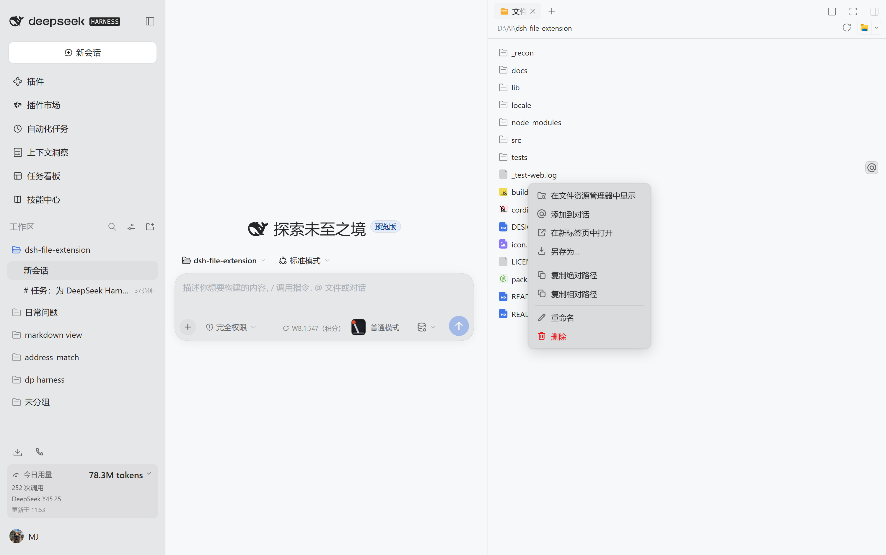

# dsh-file-extension

[English](README.md) | 中文

为 [DeepSeek Harness](https://github.com/deepseek-ai/deepseek-harness) 网页版与桌面版的
**右侧栏文件树**补全 Trae 风格的文件操作：右键任意文件弹出自制上下文菜单，悬停任意条目
浮现一键 **@** 按钮，删除默认移入**操作系统回收站**而不是直接销毁文件。

> **状态：** 已在 dsh `0.2.1-rc.2`（Windows 11）实机验证。见[兼容性](#兼容性)。



---

## 目录

- [功能](#功能)
- [安装](#安装)
- [卸载](#卸载)
- [兼容性](#兼容性)
- [网页版与桌面版差异](#网页版与桌面版差异)
- [已知限制](#已知限制)
- [接线说明](#接线说明)
- [开发](#开发)
- [验证清单](#验证清单)
- [许可证](#许可证)

---

## 功能

### 文件右键菜单

在右侧栏文件树中右键任意文件。菜单由插件自绘，**不与原生右键菜单混杂**，并使用 dsh
主题令牌，因此自动跟随浅色 / 深色主题。

| 菜单项 | 行为 |
|---|---|
| **在文件资源管理器中显示** | 在 Finder / 资源管理器 / 桌面文件管理器中定位并选中该文件。宿主不支持时置灰并给出 tooltip。 |
| **添加到对话** | 在输入框光标处插入 `@路径`，不覆盖已有草稿。含空格的路径使用带引号的 `@"路径"` 形式。 |
| **在新标签页中打开** | 在右侧面板的预览区新标签页中打开该文件。 |
| **另存为…** | 以新文件名、新目录写出副本，默认名为 `原名-副本.扩展名`。**绝不修改原文件**；同名时先询问是否覆盖。 |
| **复制绝对路径** | 复制完整路径并给出 toast。 |
| **复制相对路径** | 复制相对工作区的路径并给出 toast。 |
| **重命名** | 在条目上原地弹出输入框，并选中主文件名。`Enter` 确认、`Esc` 取消、点击别处取消。 |
| **删除** | **将文件移动到操作系统回收站**，并在确认框中明确说明。仅当宿主确实无法访问回收站时，才降级为永久删除并改用红色警示文案。 |

菜单行为：点击外部或 `Esc` 关闭，支持 `↑`/`↓`/`Home`/`End` 键盘导航并跳过置灰项，
在视口任意边缘自动翻转，不会溢出。

### 悬停 @ 按钮

鼠标悬停任意文件条目时，其右侧浮现一个 `@` 按钮，带「添加到对话」tooltip。
按钮是**覆盖**在条目上的，不插入行内，因此长文件名仍保持省略号截断、条目不会重排。
点击等效于菜单中的「添加到对话」。

### 目录条目

目录条目提供**在文件资源管理器中显示**、**复制绝对路径**、**复制相对路径**、
**重命名**、**删除文件夹**。删除文件夹时会说明将整个目录移入回收站，并要求二次确认。

### 其他

- 所有文件操作完成后状态保持一致：文件树通过自身的目录监听自动刷新；删除正在预览的
  文件时会同时关闭其预览标签。
- 界面文案中英双语，跟随 dsh 的 locale 服务。
- 插件卸载或热更新时，菜单、按钮、对话框、样式、事件监听、`MutationObserver`
  与所有 slot 注册都会被完整清理。

---

## 安装

```bash
dsh plugin --profile web add github:badwoo/dsh-file-extension
```

随后重启 harness，并在浏览器中硬刷新（`Ctrl+Shift+R`）。

**桌面版：** 桌面 profile 由 Electron 应用独占管理，`dsh plugin --profile desktop`
会拒绝操作。请通过应用内的 **设置 → 插件 → 添加** 安装，或手动把包加入桌面 profile
的 `package.json` 与 `dsh.profile.bundles` 后重启应用。

### 从本地目录安装

```bash
git clone https://github.com/badwoo/dsh-file-extension.git
cd dsh-file-extension
dsh plugin --profile web add "$(pwd)"
```

`lib/` 已随仓库提交，安装时无需本地构建。

---

## 卸载

```bash
dsh plugin --profile web remove dsh-file-extension
```

重启 harness 并硬刷新浏览器。不会留下任何残留：没有路由、没有样式标签、没有监听器。
可这样确认：

```js
// 浏览器控制台
document.querySelector('style[data-plugin="dsh-file-extension"]')  // null
```

```bash
curl -i http://127.0.0.1:端口/api/dsh-file-extension/capabilities   # 404
```

---

## 兼容性

| dsh 版本 | 桌面版（Electron） | 网页版 | 说明 |
|---|---|---|---|
| `0.2.1-rc.2` | ✅ 已验证 | ✅ 已验证 | Windows 11；17 项浏览器检查 + 25 项文件操作检查全部通过 |
| 其他 `0.2.x` | ⚠️ 预期可用 | ⚠️ 预期可用 | 依赖下表中的 `data-files-*` 行属性 |

插件只从官方界面读取三个属性。若未来版本改名，菜单与悬停按钮会**静默失效而不是报错**，
修复只需改 `src/client/controller.js` 里的一行常量：

| 属性 | 归属包 | 用途 |
|---|---|---|
| `data-files-entry` | `dsh-client-ui-sidebar-files` | `file` / `directory` / `other` |
| `data-files-path` | `dsh-client-ui-sidebar-files` | 该行的绝对路径 |
| `data-sidebar-right-session` | `dsh-client-ui-sidebar-right` | 面板当前显示的会话 |

---

## 网页版与桌面版差异

插件运行在浏览器中，但所有文件系统操作都在**宿主机器**上通过
`/api/dsh-file-extension/*` 路由执行。因此「能否显示 / 另存 / 回收站」取决于**宿主**，
而不是浏览器所在机器。

| 功能 | 桌面版 | 网页版（宿主同机） | 网页版（宿主在别处） |
|---|---|---|---|
| 在文件资源管理器中显示 | ✅ 原生 | ✅ 经宿主的桌面打开器 | ❌ 置灰并给出 tooltip |
| 添加到对话 | ✅ | ✅ | ✅ |
| 在新标签页中打开 | ✅ | ✅ | ✅ |
| 另存为 | ✅ 原生目录选择 + 宿主写盘 | ✅ 原生目录选择 + 宿主写盘 | ⬇️ 降级为浏览器下载（上限 32 MiB，超出先提示大小） |
| 复制路径 | ✅ | ✅ | ✅ |
| 重命名 | ✅ 宿主文件系统 | ✅ 宿主文件系统 | ✅ 宿主文件系统 |
| 删除 | ♻️ 回收站 | ♻️ 回收站 | ♻️ 取决于宿主操作系统 |

**另存为**使用平台的**原生目录选择器**加上插件自己的文件名输入框，而不是原生保存对话框：
dsh 的桌面壳只暴露了目录选择的 IPC 通道，没有保存对话框通道。行为等价（可改名、可换目录、
覆盖前会询问），但对话框由插件自绘。

### 各平台回收站实现

| 平台 | 实现方式 | 验证状态 |
|---|---|---|
| Windows | PowerShell 调用 `Microsoft.VisualBasic.FileIO.FileSystem` 的 `SendToRecycleBin` | ✅ 文件与目录均确认出现在 `D:\$Recycle.Bin` 中 |
| macOS | 优先 `trash` CLI，否则用 Finder AppleScript | 本机未测试 |
| Linux | FreeDesktop Trash 规范（`~/.local/share/Trash` + `.trashinfo`） | 本机未测试 |

当回收站确实不可达时，插件**不会静默删除**：它会用红色警示文案
「该操作将永久删除，不可恢复。」重新打开确认框，并要求二次明确确认。

---

## 已知限制

1. **依赖 DOM 契约。** dsh 的文件树没有行级扩展点，插件依附于
   [兼容性](#兼容性)中列出的三个行属性。这是唯一的耦合面，且刻意收窄。
2. **行内重命名是覆盖层。** 输入框绝对定位覆盖在条目上（官方条目无法承载注入的组件），
   会跟随条目滚动与刷新；条目消失时自动关闭。
3. **回收站在宿主侧。** 删除发生在运行宿主进程的机器上，不是运行浏览器的机器。
4. **下载上限。** 浏览器下载降级默认拒绝超过 32 MiB 的文件（插件配置项
   `maxDownloadBytes`）。
5. **显示功能依赖 `open-in-app`。** 若某部署未挂载 `session.openWorkspacePath`
   这个 Remote，「在文件资源管理器中显示」会保持置灰。
6. **极小概率竞态。** 宿主会拒绝覆盖已存在的目标，但在检查与写入之间新建的文件仍可能
   被系统级复制覆盖。这与任何保存对话框的窗口期相同。

---

## 接线说明

### Bundle 补丁

`cordis.patch.yml` 插入一条 loader 行：

```yaml
- insert:
    - id: dsh-file-extension
      name: dsh-file-extension
```

`package.json` 用 `dsh.bundle.patch` 指向它，因此 `dsh plugin add` 一步完成
依赖安装 + loader 注册。

### 关键 package.json 字段

| 字段 | 值 | 作用 |
|---|---|---|
| `exports["."]` | `./lib/index.js` | loader 会 `import()` 包根来加载 Host 半边 |
| `exports["./client"]` | `./lib/client.js` | 浏览器模块系统按此提供客户端 bundle |
| `dsh.bundle.patch` | `./cordis.patch.yml` | 让该包成为 bundle |
| `dsh.client.platform` | `web` | 声明为浏览器插件 |
| `dsh.client.immediately` | `true` | 启动即加载，而非首次使用时 |
| `dsh.client.inject` | slots / sidebar-right / conversation / locale / remotes / session-controller | 仅用于激活顺序 |
| `files` | `lib/`、补丁、locale、图标、README、LICENSE | 控制发布包体积 |
| `peerDependencies` | 所有 `@deepseek-ai/*` 与 `react` | 不重复打包宿主已有的模块 |

### Loader 注册位置

该行落在 profile 由 `cordis.patch.yml` 组合出的树中。可这样确认：

```bash
dsh --profile web --dump-config | grep -A2 "dsh-file-extension"
```

### 运行时组成

| 组成 | 位置 | 生命周期 |
|---|---|---|
| Host 路由 `/api/dsh-file-extension/*` | `ctx.effect` 内的 `ctx.webServer.register` | 卸载即移除 |
| 上下文菜单、对话框、toast | `shell.overlay` slot | 卸载即移除 |
| 输入框 `inputActions` 捕获 | `conversation.input.dock` slot | 卸载即移除 |
| 行监听 + `MutationObserver` | `document`，包在 `ctx.effect` 内 | 卸载即移除 |
| 样式表 | 一个 `<style data-plugin="dsh-file-extension">` | 卸载即移除 |
| 语言词典 | `ctx.locale.register` | 卸载即移除 |

每条路由都用 `ctx.connection.requestRejection` 鉴权，因此插件路由与官方路由同样受保护：
未鉴权请求返回 `401`。

---

## 开发

```bash
npm install          # 仅需 esbuild
node build.mjs       # src/ -> lib/
```

`src/host/` 是普通 ES 模块。`src/client/` 打包为 CommonJS 后包进
`window.__ModuleLoader__.load({ id, factory })`，因为浏览器模块系统只注册工厂函数。
`react` 与平台模块表保持外部引用。

### 目录结构

```
src/host/
  index.js       apply()、Config、HTTP 路由、鉴权
  contract.js    共享错误码、文件名校验、副本命名
  fsops.js       stat / rename / remove / copy / download
  trash.js       各平台回收站 + 永久删除降级
src/client/
  index.js       inject、apply、slot 注册、服务接线
  actions.js     控制器：store + Host 调用 + 侧栏/输入框动作
  controller.js  DOM 绑定：行发现、事件委托、观察器
  overlay.jsx    浮层根：悬停按钮、行内重命名、toast 栈
  menu.jsx       上下文菜单（键盘导航 + 边缘翻转）
  dialogs.jsx    删除 / 重命名 / 另存为 / 覆盖确认对话框
  icons.jsx      内联 SVG 图标
  locales.js     中英双语文案
  styles.js      主题令牌 CSS
```

### 测试

两套测试都驱动真实环境，需要一个运行中的实例：

```bash
# 浏览器：加载页面、右键真实条目、走完每个对话框
$env:DSH_TEST_URL="http://127.0.0.1:端口/?token=..."
$env:DSH_TEST_CHROME="C:\Program Files\Google\Chrome\Application\chrome.exe"
node tests/smoke.mjs

# 文件系统：真实重命名、复制、删除，并确认被删文件确实进了系统回收站
$env:DSH_TEST_BASE="http://127.0.0.1:端口"
$env:DSH_TEST_TOKEN="..."
$env:DSH_TEST_WORKSPACE="D:\path\to\workspace"
$env:DSH_TEST_SESSION="session-..."
node tests/operations.mjs
```

---

## 验证清单

安装后重启 `dsh web`、硬刷新浏览器，然后逐项走查。

**打开文件树：** 右侧栏 → 引导页 → **工作区文件**。

| # | 检查项 | 预期 |
|---|---|---|
| 1 | 右键一个文件 | 出现插件菜单，且没有原生菜单 |
| 2 | 菜单外观 | 跟随主题；切换深浅色后重新打开确认 |
| 3 | `↑` / `↓` / `Home` / `End` | 高亮移动，跳过置灰项 |
| 4 | `Esc`、点击外部 | 菜单关闭 |
| 5 | 在右下角附近右键 | 菜单翻转，完整留在视口内 |
| 6 | 在文件资源管理器中显示 | 资源管理器打开并选中该文件 |
| 7 | 添加到对话 | 光标处插入 `@路径`，已有草稿保留 |
| 8 | 在 mention 后继续输入并再加一个 | 两个 mention 并存 |
| 9 | 在新标签页中打开 | 文件在右侧新标签页中打开 |
| 10 | 另存为 | 默认名为 `原名-副本.扩展名`；选目录后文件出现在该处 |
| 11 | 对同名再另存一次 | 出现覆盖确认 |
| 12 | 对比原文件与副本 | 原文件字节完全一致，只多出副本 |
| 13 | 复制绝对 / 相对路径 | 出现 toast；粘贴到输入框确认内容 |
| 14 | 重命名 → `Enter` | 条目显示新名称；主文件名已被预选中 |
| 15 | 重命名 → `Esc` | 名称不变 |
| 16 | 重命名为已存在的名称 | 报错 toast；原文件未受影响 |
| 17 | 重命名为 `a<b>.txt` | 提示「名称包含不允许的字符」；未做任何改动 |
| 18 | 悬停文件条目 | `@` 按钮在右侧淡入并带 tooltip |
| 19 | 悬停长文件名条目 | 名称仍以省略号截断；条目未位移 |
| 20 | 点击 `@` 按钮 | 等同「添加到对话」 |
| 21 | 删除一个文件 | 对话框说明将移入回收站 |
| 22 | 确认后**打开系统回收站** | **文件确实在其中** |
| 23 | 删除正在预览的文件 | 其预览标签同时关闭 |
| 24 | 右键一个文件夹 | 仅显示 显示 / 复制 / 重命名 / 删除文件夹 |
| 25 | 删除文件夹 | 确认文案说明将删除整个目录并移入回收站 |
| 26 | 切换到英文 locale | 所有菜单与对话框文案变为英文 |
| 27 | 在设置 → 插件中禁用 | 菜单、`@` 按钮、样式全部消失 |
| 28 | 重新启用 | 无需刷新页面即全部恢复 |

**卸载后的残留检查：**

```js
// 移除插件并刷新后，在浏览器控制台执行
document.querySelector('style[data-plugin="dsh-file-extension"]')  // null
document.querySelectorAll('.dfx-menu, .dfx-row-at, .dfx-dialog').length // 0
```

```bash
curl -i http://127.0.0.1:端口/api/dsh-file-extension/capabilities   # 404
```

---

## 许可证

[MIT](LICENSE)
